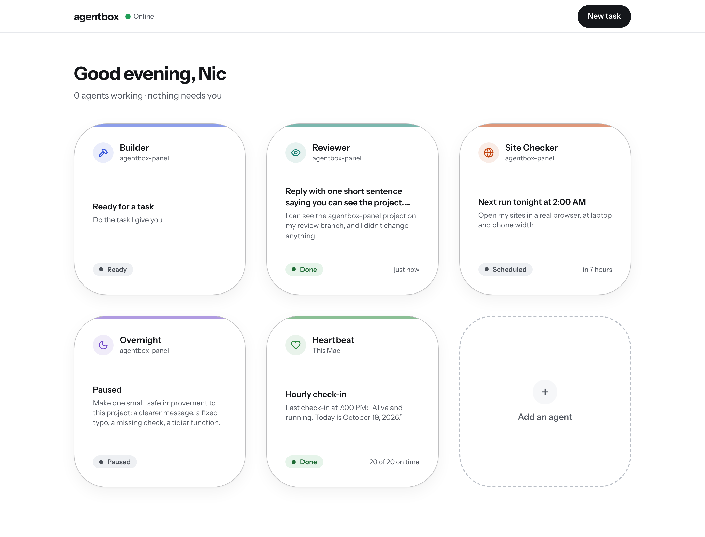

# agentbox-panel

A private web panel for controlling the AI agents that run on agentbox. See every agent at a glance, give them tasks, approve their plans and steps, and watch their pull requests.



## How to open it

The panel runs all the time on agentbox (a LaunchAgent in the `agent` account keeps it going, even after a restart or crash). It only listens on `127.0.0.1:3000`, so nothing outside the Mac can reach it directly. Tailscale is the lock: there is no login.

**One-time setup, from the admin account** (Tailscale belongs to the admin account, so the `agent` account can't do this):

```sh
/Applications/Tailscale.app/Contents/MacOS/Tailscale serve --bg 3000
```

Then run `/Applications/Tailscale.app/Contents/MacOS/Tailscale serve status` to see the address. It looks like `https://agentbox.<your-tailnet>.ts.net`. Open it on any device signed in to your tailnet (laptop or phone). Never use `tailscale funnel`; that would make it public.

On agentbox itself you can also just open http://127.0.0.1:3000.

## Running it

| What | How |
| --- | --- |
| Install or update the always-on service | `./scripts/install-launchagent.sh` (builds the app and restarts it) |
| Restart it | `launchctl kickstart -k gui/$(id -u)/com.agentbox.panel` |
| Stop it until next login | `launchctl bootout gui/$(id -u)/com.agentbox.panel` |
| Its logs | `~/agents/panel/out.log` and `err.log` |
| Develop locally | `npm run dev` (stop the service first, both use port 3000) |

Data lives in `data/agentbox.db` (SQLite) and run logs in `data/logs/`. Both are ignored by git.

## How it works

- **Agents** are rows in SQLite: a prompt in your own words plus a few exact settings (project, schedule, what it's allowed to do, how it works with you, time limit, model, notifications).
- **A run** makes a git worktree on a new branch `agent/<agent>-<task>-<number>`, starts Claude Code headless in it (`claude -p --output-format stream-json`), and reads its stream to show plain-English steps. When it finishes, the panel commits anything left over, pushes the branch and opens a pull request with `gh`. The status goes Working → Needs you (pull request open) → Done when you merge it. Errors, usage limits, time limits and the Stop button end in Stopped.
- **How it works with you:**
  - *Auto* uses Claude Code's `auto` permission mode (a safety checker approves each step).
  - *Plan first* runs in `plan` mode, shows you the plan, and resumes the same session in `auto` when you press Approve plan. Change it sends your note back for a new plan.
  - *Ask me each step* uses `manual` mode with a `PermissionRequest` hook (`scripts/agentbox-hook.mjs`) that asks the panel and waits for your Allow or Deny.
  - *Look only* removes the editing tools and never pushes or opens a pull request. The result is a report.
- **Safety:** agents never use `bypassPermissions`. A `PreToolUse` hook blocks any push to main/master, force pushes, and every push unless the agent is set to Make changes. The panel itself only ever pushes the agent's own branch.
- **Schedules** run inside the server process (checked every 30 seconds). Runs missed while the Mac was asleep are skipped, not replayed.
- **Heartbeat** is the existing `com.agentbox.heartbeat` launchd job, shown read-only. Its logs stay empty when it works, so the panel reads each check-in from the Claude Code transcript it leaves behind.
- **Discord pings** use the webhook stored in the Keychain as `discord-heartbeat`. It is read when needed and never saved anywhere else.

## Tests

With the panel running:

```sh
node scripts/ui-check.mjs out/              # screenshots at laptop + phone width, flags sideways scrolling and small tap targets
node scripts/editor-test.mjs                # create, edit and delete an agent through the UI
node scripts/run-flow-test.mjs out/         # real runs: Ask me each step, Plan first, Stop (uses a little Claude usage)
```
