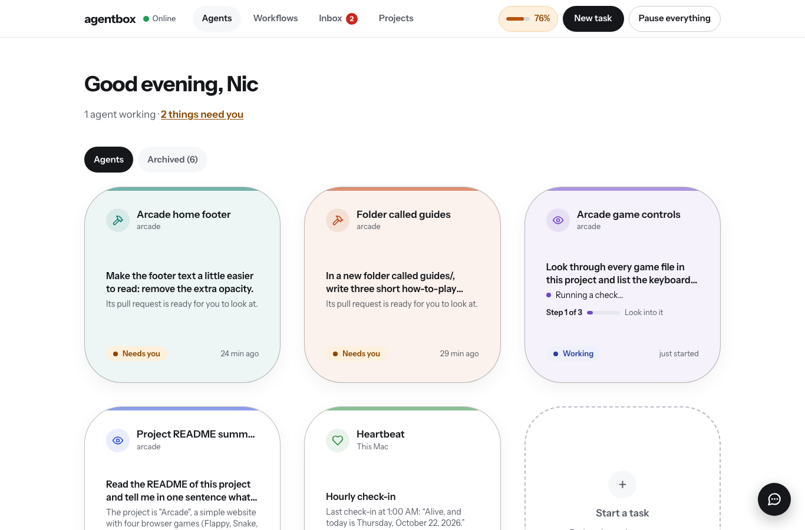
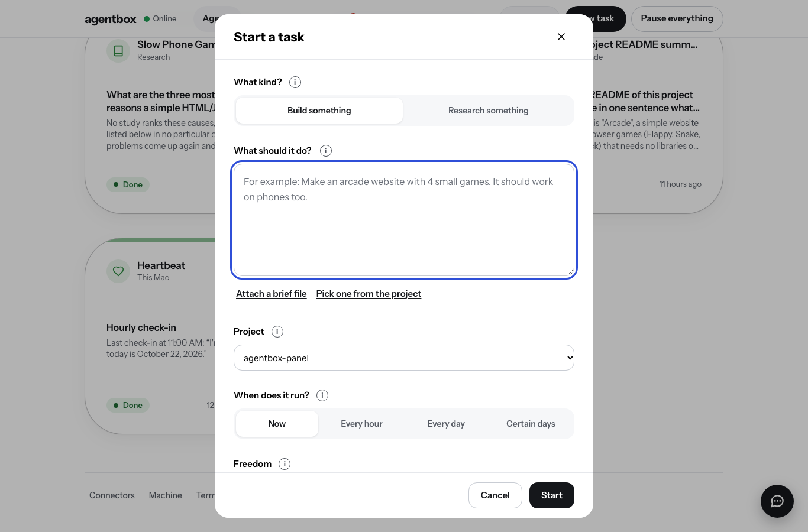
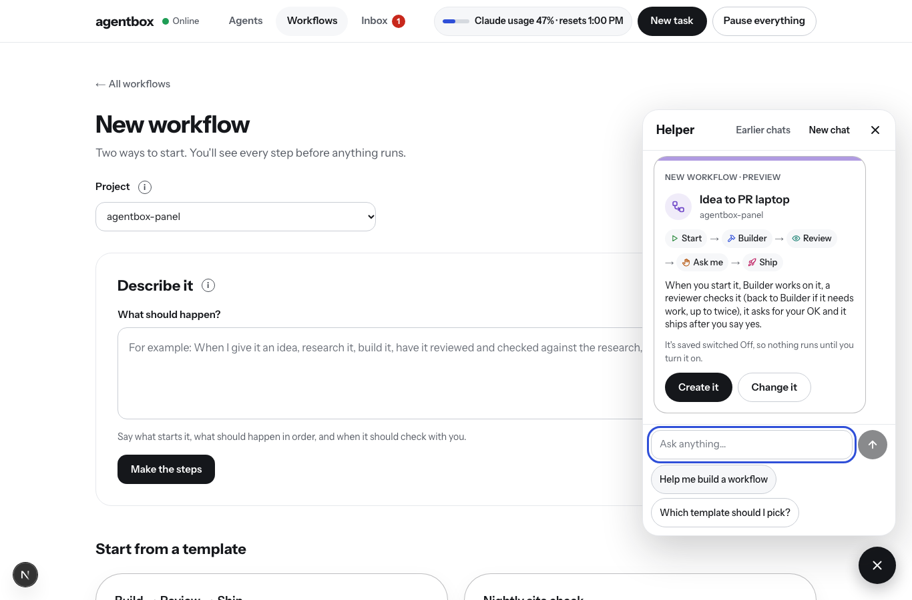

# agentbox-panel

A private web panel for controlling the AI agents that run on agentbox. Start a task (each one becomes its own agent), watch it work, approve its plans and steps, see what changed, play what it built, and read research reports. Everything happens in the panel.



## How to open it

The panel runs all the time on agentbox (a LaunchAgent in the `agent` account keeps it going, even after a restart or crash). It only listens on `127.0.0.1:3000`, so nothing outside the Mac can reach it directly. Tailscale is the lock: there is no login.

**One-time setup, from the admin account** (Tailscale belongs to the admin account, so the `agent` account can't do this):

```sh
/Applications/Tailscale.app/Contents/MacOS/Tailscale serve --bg 3000
```

Then run `/Applications/Tailscale.app/Contents/MacOS/Tailscale serve status` to see the address. It looks like `https://agentbox.<your-tailnet>.ts.net`. Open it on any device signed in to your tailnet (laptop or phone). Never use `tailscale funnel`; that would make it public.

On agentbox itself you can also just open http://127.0.0.1:3000.

## Running it

| What | How |
| --- | --- |
| Update it (normal way) | **Settings → Update agentbox** in the panel: builds the new version on the side, switches, rolls back by itself if it doesn't start |
| Install or reinstall the always-on service | `./scripts/install-launchagent.sh` (builds the app and restarts it) |
| Restart it | `launchctl kickstart -k gui/$(id -u)/com.agentbox.panel` |
| Stop it until next login | `launchctl bootout gui/$(id -u)/com.agentbox.panel` |
| Its logs | `~/agents/panel/out.log` and `err.log` |
| Try changes safely | `scripts/dev-copy.sh fresh` (a separate copy: its own database copy, port 3100, no schedules, no Discord) |

Data lives in `data/agentbox.db` (SQLite) and run logs in `data/logs/`. Both are ignored by git.

## How it works

- **Agents** are rows in SQLite: a prompt in your own words plus a few exact settings (project, schedule, what it's allowed to do, how it works with you, time limit, model, notifications).
- **A run** makes a git worktree on a new branch `agent/<agent>-<task>-<number>`, starts Claude Code headless in it (`claude -p --output-format stream-json`), and reads its stream to show plain-English steps. When it finishes, the panel commits anything left over, pushes the branch and opens a pull request with `gh`. The status goes Working → Needs you (pull request open) → Done when you merge it. Errors, usage limits, time limits and the Stop button end in Stopped.
- **How it works with you:**
  - *Auto* uses Claude Code's `auto` permission mode (a safety checker approves each step).
  - *Plan first* runs in `plan` mode, shows you the plan, and resumes the same session in `auto` when you press Approve plan. Change it sends your note back for a new plan.
  - *Ask me each step* uses `manual` mode with a `PermissionRequest` hook (`scripts/agentbox-hook.mjs`) that asks the panel and waits for your Allow or Deny.
  - *Look only* removes the editing tools and never pushes or opens a pull request. The result is a report.
- **Safety:** agents never use `bypassPermissions`. A `PreToolUse` hook blocks any push to main/master, force pushes, and every push unless the agent is set to Make changes. The panel itself only ever pushes the agent's own branch.
- **Schedules** run inside the server process (checked every 30 seconds). Runs missed while the Mac was asleep are skipped, not replayed.
- **Heartbeat** is the existing `com.agentbox.heartbeat` launchd job, shown read-only. Its logs stay empty when it works, so the panel reads each check-in from the Claude Code transcript it leaves behind.
- **Discord pings** use the webhook stored in the Keychain as `discord-heartbeat`. It is read when needed and never saved anywhere else.

## v3: one agent per job, everything in the panel, deep research



- **One agent per job.** New task opens the **Start a task** panel (`components/TaskPanel.tsx`): What should it do? · Project · When does it run? · Freedom (Look only / Check with me first / On its own) · Careful or Quick · More options (time limit, model, connectors, Tell me when, Ask me each step, Big job). Each task becomes a new agent named after the job (`lib/tasks.ts`). **Add a follow-up** continues the same job on the same branch and pull request. The old premade agents are archived.
- **Runs are supervised launchd jobs** (`lib/proc.ts`, `scripts/proc-runner.mjs`), not children of the panel: the panel reads their output files and reattaches after a restart or update. If a session is cut off (Mac restart), it carries on with `--resume`.
- **The run engine** (`lib/runner.ts`) is a series of sessions: Quick = work → pull request; **Careful** = work → review by the other model → fix (up to 2 rounds) → polish → final check → pull request; **Big job** = plan milestones → one fresh session per milestone with a written handoff, committing and pushing after each, with a usage budget instead of a time cap. Usage limits never stop a run: it waits and continues in the same conversation. Its own time limit stops it as *Ran out of time* with **Keep going**.
- **See what changed** (`/changes?pr=…`, `lib/changes.ts`): a plain summary, before/after screenshots taken with Playwright from previews of both branches, the diff behind a toggle, Merge / Send back / Comment. Pull requests not made in Careful mode are reviewed automatically (`lib/prReview.ts`).
- **Preview / Play** (`/preview/<project>/<branch>/…`, `lib/preview.ts`) serves a project's static files from a read-only worktree; `proxy.ts` sends a previewed site's top-level links to it.
- **Update agentbox** (`scripts/update-panel.sh`, run as its own launchd job): builds next to the running version (`.next-a` / `.next-b`, active one in `.active-build`, started by `scripts/start-panel.sh`), test-starts it on port 3001, switches, checks `/api/ping` reports the new version, and rolls back if not.
- **Machine** and **Terminal** pages (`lib/machine.ts`; `lib/terminal.ts` + `scripts/pty-bridge.py` + xterm.js). `proxy.ts` refuses changes from other websites.
- **Shipped** items and **reports** in the Inbox (`lib/notices.ts`), with filters. Discord messages wait for Discord's confirmation and are logged (Settings → Discord messages).
- **Deep research** (`lib/research.ts`): a research method and report format shared by research tasks and workflow Research steps; reports are stored in SQLite, shown on `/reports/N` with PDF (Playwright) and Markdown downloads (`lib/markdown.ts` renders them safely).
- **Connectors** (`lib/connectors.ts`, `lib/connectorStatus.ts`): status from `claude mcp list` (claude.ai connectors), per-task choices turned into `--disallowedTools` for everything not ticked, and the safety hook asks Nic before any tool that sends, deletes or books.

## v2: workflows, usage meter, Inbox

- **Shared header** on every page: Agents · Workflows · Inbox (with a count), the usage meter, New task and Pause everything. On phones the three pages are tabs at the bottom and the rest is in Menu.
- **Usage meter** reads Claude Code's own numbers: `claude -p /usage --output-format json` (a local command that costs nothing) every few minutes, plus the `rate_limit_event` that every headless run streams (`unifiedWindows.five_hour` / `seven_day` utilization and exact `resetsAt`). Per-run cost and tokens from each run's `result` event are saved in SQLite for the "today by agent / by workflow" split. When usage runs out (or passes the optional limit in Settings) new runs are saved as *queued* and start by themselves after the reset.
- **Inbox** collects pending Allow/Deny questions, plans, pull requests waiting for review, stopped runs and workflows waiting at Ask me or Ship, each with its buttons inline. It also has an Ideas list.
- **Workflows** (`lib/wf.ts` for the step types and templates, `lib/workflowRunner.ts` for the engine). One run = one git worktree on `agent/wf-…`, one draft pull request that every step comments on. Agent-like steps reuse the v1 runner (same hooks, approvals and main/force-push block; workflow steps also can't `gh pr merge`). Review and Check can send work back to an earlier step up to the loop limit. Check runs real gates in `lib/checks.ts` (npm test, Playwright page load, console errors). Ship merges with `gh pr merge --squash`; it never ships agentbox-panel on its own. Test runs stop before Ship and never send Discord messages.
- **Describe it** (`lib/draft.ts`) runs Claude Code headless with `--tools ""` (no tools at all) and `--json-schema`, then opens the draft switched off.
- **Projects** clones with `gh repo clone` or makes a public repo with `gh repo create --public --add-readme --clone` into `~/projects`.

## v2.1: the Helper chat bubble



- **A round chat bubble** in the bottom-right corner of every page (above the tabs on a phone) opens the Helper: a 380px panel on a laptop, a full-height sheet on a phone. It explains the site and what's on screen, says what's running and why something stopped, and drafts agents and workflows.
- **What it's sent with every message:** where Nic is (page, the open agent or workflow, the selected step, the run on the canvas, what's typed in the agent editor, any error box on screen), a fresh plain-text snapshot of the panel (`lib/helperSnapshot.ts`: agents, recent runs with their steps and log tails, workflows and live runs, Inbox, ideas, usage, projects, heartbeat), the last 14 messages, and a built-in guide to every page and control plus the Help page text (`lib/helperGuide.ts`, `lib/helpText.ts`).
- **How it runs** (`lib/helper.ts`): `claude -p` with Sonnet, `--tools ""` (no files, no shell), `--strict-mcp-config` with one tiny local MCP server (`scripts/helper-mcp.mjs`) whose 8 tools only *read* through `/api/helper/tools` (a run's full log, a run's details, an agent's settings, a workflow, a workflow run, a pull request's live state via `gh`, projects, heartbeat). `--permission-mode dontAsk` with only those tools allowed, `--setting-sources ""`, `--no-session-persistence`, and an empty working folder (`~/agents/helper-room`), never inside a project. Replies stream (`--include-partial-messages`) to the browser as JSON lines from `/api/helper/stream`, and a reply keeps going (and is saved) if the page changes or reloads.
- **Chips, buttons and cards:** the Helper writes small markers (`[[agent:3|Builder]]`, `[[button:retry_run:12|Try again]]`, a fenced `agent-preview` / `workflow-preview` block). When the reply ends, the server checks every one: chips to things that don't exist become plain text, buttons only survive if they still make sense (e.g. *Try again* only on a stopped run), and cards are cleaned with the same validation as the editors. Buttons call the same endpoints as the rest of the site; *Merge*, *Ship* and *Pause everything* show the same "Are you sure?". **Create it** saves the agent or workflow switched **Off** and opens it in the normal editor.
- **Saved chats:** `helper_chats` and `helper_messages` in SQLite, the last 20 kept. **New chat** starts fresh; **Earlier chats** shows the old ones. Works across laptop and phone.
- **Usage:** each reply's cost is added to a daily total shown as **Helper** in the usage meter's "Today, by agent". When usage is out, the panel says so with the reset time instead of calling Claude.

## Tests

With the panel running:

```sh
node scripts/ui-check.mjs out/              # screenshots at laptop + phone width, flags sideways scrolling and small tap targets
node scripts/editor-test.mjs                # create, edit and delete an agent through the UI
node scripts/run-flow-test.mjs out/         # real runs: Ask me each step, Plan first, Stop (uses a little Claude usage)
node scripts/m1-test.mjs out/               # header, usage panel, Pause everything, Inbox, ideas
node scripts/m2-test.mjs out/               # workflow templates, editor, undo, drag, versions
node scripts/m3-test.mjs out/               # Describe it (uses a little Claude usage)
node scripts/walkthrough.mjs out/           # screenshots of every page at both widths
node scripts/helper-test.mjs out/           # Helper: bubble, streamed reply, saved across reload (a little usage)
npm test                                     # 31 quick checks (Helper, job names, Freedom, task input, Careful line, reattaching to output), no app and no usage
BASE_URL=http://127.0.0.1:3100 DB=/tmp/agentbox-dev/agentbox.db node scripts/helper-calm-test.mjs out/  # Helper: calm typing, New text button, sneaky log, Create it twice (a little usage)
node scripts/helper-test2.mjs out/          # Helper: suggestions, buttons, Are you sure?, Create it cards (some usage)
node scripts/helper-walkthrough.mjs out/ 1366  # Helper: a beginner question on every page, answers saved to a file
```

v3 browser checks, against the dev copy (`scripts/dev-copy.sh`, port 3100):

```sh
node scripts/v3/pages.mjs / /inbox /machine …   # any pages: console errors, sideways scrolling, tap targets, at 1366px and 390px
node scripts/v3/m1.mjs        # Start a task, one agent per job, follow-ups, archive (a little usage)
node scripts/v3/m2.mjs …      # Ran out of time → Keep going, Careful line, big job page
node scripts/v3/m4.mjs 3      # busy tiles, Shipped in the Inbox, Discord settings, workflow task box and steps (a little usage)
node scripts/v3/m56.mjs …     # research panel, Reports, Report page, Connectors
node scripts/v3/term.mjs      # the Terminal page
```

To try changes without touching the always-on service: `scripts/dev-copy.sh fresh` (copies the database, port 3100, schedules and Discord off, a production build in `.next-dev`).
